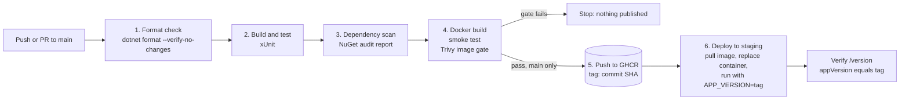

# WORKLOG

## 1. Summary
A small ASP.NET Core 8 Minimal API service (`/version`, `/healthz`, `/readyz`, `/whoami`, `/metrics`) packaged as a
non-root container, built, tested, scanned (Trivy) and published to GHCR by GitHub Actions.
Repo link: (https://github.com/omnibro/bjnew_hire_tech_assessment)

## 2. Pipeline diagram



## 3. Decisions and Reasoning
| Decision | Reasoning |
|---|---|
| Build-metadata service as the app | Small code surface, so effort went into pipeline quality; `/version` proves which commit is running. 
| Multi-stage Dockerfile | SDK image only for building; runtime image is smaller with fewer packages to scan. |
| Restore before copying source | Keeps the dependency layer cached between builds. |
| Non-root (`USER app`) | Limits blast radius if the app is compromised. |
| Two jobs | Fast feedback on code problems before spending time on image build and scan. |
| Smoke test the real image | Unit tests don't prove the container starts and serves traffic. |
| Image tagged with commit SHA | Immutable and traceable. `latest` is convenience only. |
| Publish only on `main` push | PRs get build, test and scan but never publish. |
| Least-privilege `permissions:` | Workflow token gets only what each job needs. |
| Scan before push | A failing gate means nothing reaches the registry. |

## 4. Findings/Challenges(in section 6) 

### 4.1 Deliberately vulnerable package
`Newtonsoft.Json 9.0.1` added to `barak_tech_assesment.csproj` per the assessment brief.

- NuGet audit (restore warning / `dotnet list package --vulnerable`): TODO paste output
- Trivy result: TODO paste the relevant table rows (package, installed version, fixed version, CVE/GHSA, severity)
- Where Trivy found it (hint: the published `BuildInfo.Api.deps.json` inside the image): TODO confirm
- Other findings (base image OS packages?): TODO

### 4.2 Gate behaviour
| Step | `TRIVY_EXIT_CODE` | Package version | Result | Run link |
|---|---|---|---|---|
| 1. Baseline | `0` | 9.0.1 | green, finding reported | TODO |
| 2. Enforce | `1` | 9.0.1 | red, gate blocked publish | TODO |
| 3. Fix | `1` | 13.0.3 | green, clean scan, image pushed | TODO |

## 5. Remediation
TODO: what you changed, how you verified (rerun scan output), and any breaking-change considerations
when jumping several major versions of a dependency.

## 6. Problems hit
Ran into issues getting the Docker image to run
Was unable to get the docker image to properly gate
Trivy scan failed due to timeout error, tried increasing timeout threshold but need more time to resolve persisting issues

## 7. What I'd do next/Pression from here
- Include controllers or dependency injection
- Kubernetes manifests with the probes, resource limits and a read-only root filesystem
- Chiseled/distroless base image to shrink the OS attack surface
- SBOM generation and image signing (Syft, cosign)
- Dependabot for NuGet, Docker and Actions updates
- Pin third-party actions to commit SHAs
- Real metrics via OpenTelemetry/prometheus-net and an alert on failed health checks
- Overall increase in complexity

  ## 8. Reflection
  To begin I think this technical assessment was a very good task to gauge the general understanding and capability of a junior DevOps engineer. As mentioned in the assignment, "this is close to what we actually do here". Before this technical assessment I grasped the theoretical principles which define docker/containerization, configuration files, and Restful APIs. Now after attempting this technical assessment I now truly see how the concepts would work together and be executed in a production environment. Thank you for this opportunity. To answer the question given in the brief "Format check, test, security scan — if all three could run in parallel instead of sequentially, would you? What do you gain, what do you risk? The main upside to be gained running sequentially is speed of execution especially at scale. The main risks being concurrency issues or error jamming which could lead to corrupted data. "Where do secrets live in your pipeline? What's the blast radius if one leaks into a log line?" In my case secrets live in encrypted keys, and as it stands the entire pipeline could be compromised.
  "our Trivy gate uses --ignore-unfixed. A base-image CVE that had no fix gets one next month. Nothing in your pipeline
catches that automatically. What's the gap, how do you close it?" The pipeline scans once, at build time, and only when someone pushes. --ignore-unfixed makes that worse in one specific way, a CVE with no fix is invisible at build time, and when a fix lands next month, nothing re-evaluates it. The fix is to rescan what's published more frequently, then rebuild on a schedule so the fix reaches the image.

"If this needed 3 replicas behind a load balancer instead of one docker run, what's the smallest realistic next step — and
what would you explicitly not try to solve with a Dockerfile change alone?"
The best solution I can think of is to run three copies of the same image behind a reverse proxy on one host, using Docker Compose. Considering a Dockerfile defines what one container contains, and most of what a multi-replica setup needs sits outside that I wouldn't try to solve traffic distribution, routing and TLS with a Dockerfile change alone.


## 8. Run it yourself
```bash
dotnet run --project src/BuildInfo.Api
docker build -t buildinfo:local --build-arg GIT_SHA=$(git rev-parse HEAD) .
docker run --rm -p 8080:8080 buildinfo:local
curl localhost:8080/version
trivy image buildinfo:local
```
