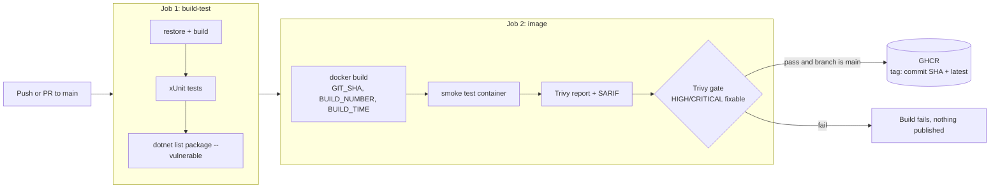

# WORKLOG

## 1. Summary
A small ASP.NET Core 8 Minimal API service (`/version`, `/healthz`, `/readyz`, `/whoami`, `/metrics`) packaged as a
non-root container, built, tested, scanned (Trivy) and published to GHCR by GitHub Actions.
Repo: TODO link  |  Successful run: TODO link  |  Image: TODO ghcr.io link

## 2. Pipeline diagram



## 3. Decisions and Reasoning
| Decision | Reasoning |
|---|---|
| Build-metadata service as the app | Tiny code surface, so effort goes into pipeline quality; `/version` proves which commit is running. |
| Multi-stage Dockerfile | SDK image only for building; runtime image is smaller with fewer packages to scan. |
| Restore before copying source | Keeps the dependency layer cached between builds. |
| Non-root (`USER app`) | Limits blast radius if the app is compromised. |
| Two jobs | Fast feedback on code problems before spending time on image build and scan. |
| Smoke test the real image | Unit tests don't prove the container starts and serves traffic. |
| Image tagged with commit SHA | Immutable and traceable. `latest` is convenience only. |
| Publish only on `main` push | PRs get build, test and scan but never publish. |
| Least-privilege `permissions:` | Workflow token gets only what each job needs. |
| Scan before push | A failing gate means nothing reaches the registry. |

## 4. Findings/Challenges(section 6) 

### 4.1 Deliberately vulnerable package
`Newtonsoft.Json 9.0.1` added to `barak_tech_assesment.csproj` per the assessment brief.

- NuGet audit (restore warning / `dotnet list package --vulnerable`): TODO paste output
- Trivy result: TODO paste the relevant table rows (package, installed version, fixed version, CVE/GHSA, severity)
- Where Trivy found it (hint: the published `BuildInfo.Api.deps.json` inside the image): TODO confirm
- Other findings (base image OS packages?): TODO

### 4.2 Gate behaviour
| Step | `TRIVY_EXIT_CODE` | Package version | Result | Run link |
|---|---|---|---|---|
| 1. Baseline | `0` | 9.0.1 | green, finding reported | TODO |
| 2. Enforce | `1` | 9.0.1 | red, gate blocked publish | TODO |
| 3. Fix | `1` | 13.0.3 | green, clean scan, image pushed | TODO |

## 5. Remediation
TODO: what you changed, how you verified (rerun scan output), and any breaking-change considerations
when jumping several major versions of a dependency.

## 6. Problems hit and how I solved them
TODO (this section is where reviewers learn the most about you)

## 7. What I'd do next
- Kubernetes manifests with the probes, resource limits and a read-only root filesystem
- Chiseled/distroless base image to shrink the OS attack surface
- SBOM generation and image signing (Syft, cosign)
- Dependabot for NuGet, Docker and Actions updates
- Pin third-party actions to commit SHAs
- Real metrics via OpenTelemetry/prometheus-net and an alert on failed health checks

## 8. Run it yourself
```bash
dotnet run --project src/BuildInfo.Api
docker build -t buildinfo:local --build-arg GIT_SHA=$(git rev-parse HEAD) .
docker run --rm -p 8080:8080 buildinfo:local
curl localhost:8080/version
trivy image buildinfo:local
```
